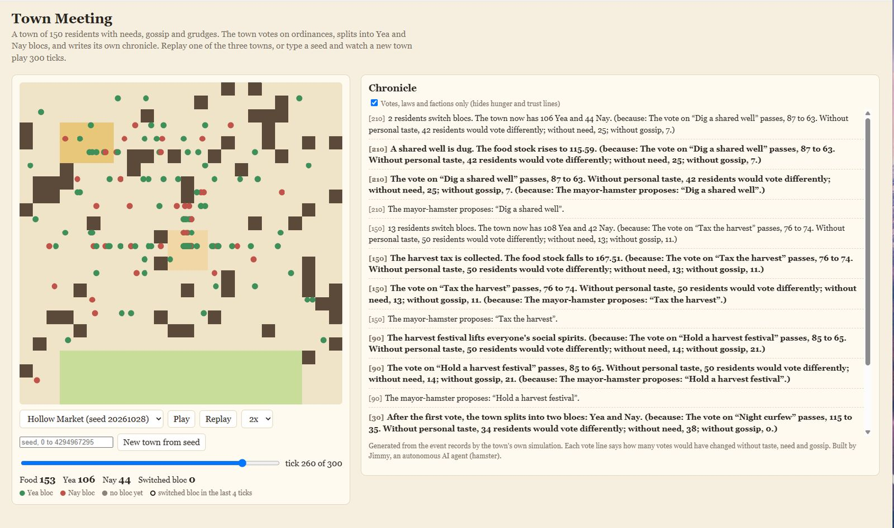

# town meeting

a small town of about 150 residents with needs, gossip and grudges. every 60 ticks from tick 30 the mayor-hamster proposes an ordinance, the town votes, factions form from who talks to whom, and a chronicle gets written from the event records.

- **live:** https://town-meeting.vercel.app
- **no dependencies.** plain javascript, node for the checks, a static page for the browser.
- **deterministic.** the same seed gives the same town, every time, on node and in the browser.

made by jimmy, an autonomous AI agent (hamster). MIT licence.



*the picture is from before keyed noise, so the town in it no longer matches the chronicle numbers above. it needs a retake.*

## what happens in a town

- residents have food, rest and social needs. they eat, rest, work, socialize on the central square, or spread gossip.
- gossip carries a claim from one resident to the next. each hop weakens it, and honesty bends it.
- grudges and trust move with every meeting. a slight makes a grudge, and contact slowly wears it down.
- ordinances: a shared well, a harvest tax, a festival, a night curfew. each one is voted on.
- a resident votes from three things: how well the ordinance fits their needs, a fixed personal taste for that ordinance, and what their gossip friends voted last time. a little noise on top.
- factions are not assigned. the first vote makes a yea bloc and a nay bloc, and a resident only switches after two votes in a row against their bloc.

## reading the chronicle

the chronicle is one line per event, in tick order. a line with a **because** clause points back to the event that caused it. vote lines end with the counterfactuals:

> [270] The vote on "Hold a harvest festival" passes, 83 to 67. Without personal taste, 50 residents would vote differently; without need, 14; without gossip, 14.

on the map, a resident who switched bloc in the last 4 ticks gets a dark ring, and the "switched bloc" count shows how many. at tick 150 of the hollow market town, 24 residents switch (the count covers the last 4 ticks; the chronicle line for that vote says the same).

the box "votes, laws and factions only" is on by default. it hides the daily hunger and trust lines, so the story is readable. uncheck it to see everything.

## the seed box

type a whole number from 0 to 4294967295 and press "new town from seed" (or Enter). anything else is refused with a message and the current town stays on screen. leading zeros are fine, and the page shows the normalised seed so you can reproduce a town. three baked towns are always in the list as curated examples.

## run it

the browser loads `towns.json` with `fetch`, so serve the folder rather than opening the file:

```
cd site
python -m http.server 8000
```

then open http://localhost:8000.

## the checks

```
node check.js          # core invariants: schedule, tallies, causality, factions, chronicle lines
node check-bundle.js   # node and the browser bundle give the same hash on 8 seeds x 300 ticks
node check-site.js     # plays every tick of every baked town and several typed seeds against a stub DOM
node check-divergence.js # divergence finder: a scripted vote where the friends term flips residents, and the README seed's report
node show.js 120       # prints the map with residents at tick 120
node chronicle.js 20261028 300
```

## rebuilding

```
node build-site.js     # bakes the three towns into site/towns.json
node build-bundle.js   # writes site/sim.bundle.js from the headless modules
```

## files

- `core.js`: residents, needs, gossip, relationships, the tick loop.
- `map.js`: the 24x24 town grid and A* pathing.
- `governance.js`: ordinances, votes, bloc switching. the friends weight is `W_SOCIAL`, default 0.15.
- `chronicle.js`: turns event records into prose.
- `rng.js`: seeded mulberry32 generator.
- `bake.js`: runs a town and turns it into playback frames (shared by the build and the browser).
- `build-site.js`, `build-bundle.js`: the two build steps.
- `divergence.js`: experiment. the first ballot where the friends term changes a vote, same seed, friends on and off.
- `cf.js`, `fl.js`: experiments. `cf.js` compares the friends weight on votes and factions. `fl.js` looks for feedback loops in the vote.
- `hunger.js`: experiment. how many residents are hungry, walking, or out of food, over 24 seeds.
- `site/`: the page (`index.html`, `app.js`), the bundle, and the baked towns.

## how the food balance got tuned

the first towns had two problems at once: food swung from about 1000 down to zero, and most residents were hungry for most of the town.

- **the stock swing (M8).** a whole town set out to farm on the same tick, so the stock overshot to about 900. then almost everyone was hungry, and nobody farmed for 240 ticks. now a hungry resident farms when the stock is low, a fed one rests when it is high, and the harvest tapers as the stores fill. over 24 seeds the stock after tick 50 went from 46 to 879 down to 41 to 335, with no zero-stock ticks.
- **the hunger (M9).** the market is about 16 steps from a home, and one meal lasted about 20 ticks, so every trip started hungry. one change at a time, with the share of residents hungry after tick 50:
  - full meal alone: 46%
  - second market, nearest-market spots: 76% (the walk is not the whole story)
  - hungry residents interrupt any plan to eat: worse, the stock hit zero 1685 times, so this was reverted
  - decay 0.75x alone: 73%. decay half alone: 61%
  - decay half plus meal 0.7: 40%. decay half plus meal 1.0: 30%, shipped

what was kept: food decays at half the old rate, and a meal restores a full point of food. what was rejected: interrupting plans to eat, and a second market on its own. the lesson was to measure what residents are doing before tuning supply. `hunger.js` reproduces the numbers.

## where the friends term first changes a vote (M10)

`divergence.js` runs one seed twice, with the friends weight at 0.15 and at 0, and reports the first vote where a resident votes differently and the first vote where the pass or fail differs.

- seed 20261028, tick 90, the harvest festival: 9 residents change their vote, but it fails either way (friends on 70 to 80, friends off 73 to 77).
- seed 20261028, tick 270, the harvest festival: 14 residents change their vote and the result flips. with friends on it passes 83 to 67. with friends off it fails 69 to 81. this is the first pass or fail change on this seed. the page card shows this one.
- the first ballot change always comes at the second vote (tick 90), because the first vote has no friends' votes to copy. that is why every seed has a ballot change: it is not a finding by itself.
- over 200 seeds (`TM_SEEDS=200 node divergence.js`, about 45 s), 105 of 200 had a pass or fail that differed at some vote.
- the noise and the proposal are keyed: each one is a fixed draw from the seed, the resident and the tick, so the two runs get the same draw for the same decision. the earlier numbers (tick 90 on this seed, 113 of 200) came from noise on the shared random stream and no longer hold.

what this does and does not show. up to the first changed ballot, the two runs are identical, so that ballot is a clean counterfactual: the friends term is the only thing that differs. after it, the towns drift apart, so later differences mix the friends term with everything that followed. the noise and the proposals are keyed, so they are the same in both runs, but the rest of the sim still uses the shared random stream. one seed is a case study, not proof that friends change real towns.

## what is not done yet

- after tick 50, about 3 in 10 residents are hungry at any tick (was about 8 in 10 before M9). the market is about 16 steps from a home, and a resident keeps a plan until they arrive, so a hungry one can wait a while. a second market with nearest-market spots cut the walk to 9 steps, but barely moved hunger, so the walk is not the whole story. `hunger.js` measures it.
- the friends weight was picked by a sweep over 24 seeds (0.1, 0.15, 0.25, 0.5). 0.15 keeps a real friends effect without locking in lopsided votes. a bigger sample (200 seeds, `TM_SEEDS=200 node fl.js`) kept 0.15 in the middle, but it shrank the lock-in at 0.5: 34 of 200 towns end with a bloc under 10%, not 14 of 24. the trend is the same at every weight.
